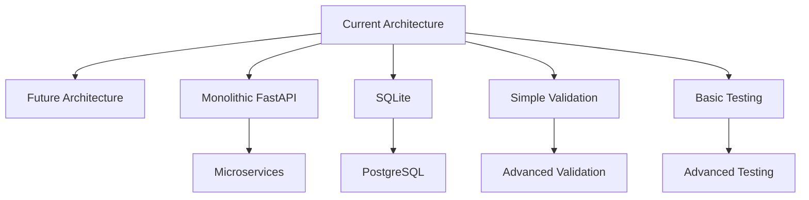

# Project Architecture

## Overview

The DevOps Incident Commander is a FastAPI-based incident management platform that follows a layered architecture for incident tracking, timeline analysis, and analytics. The project emphasizes clean code principles, comprehensive testing, and proper database transaction management.

## Architecture Components

### 1. API Layer (FastAPI)
- **Files**: `main.py`
- **Responsibility**: HTTP request handling and response generation
- **Key Features**:
  - RESTful API design
  - Input validation via Pydantic models
  - Comprehensive error handling
  - Interactive API documentation (Swagger UI)
  - CORS support

### 2. Service Layer (Pydantic Models)
- **Files**: `models.py`
- **Responsibility**: Data validation, business logic, and database operations
- **Key Components**:
  - Pydantic models for data validation
  - Database connection management
  - CRUD operations
  - Test database isolation
  - Transaction management

### 3. Data Layer (SQLite)
- **Files**: `incidents.db` (production), test databases in `/tmp/`
- **Responsibility**: Data persistence and storage
- **Key Features**:
  - SQLite database with proper schema
  - Transaction support
  - Indexes for performance
  - Connection pooling
  - Test database isolation

### 4. Test Layer (Pytest)
- **Files**: `conftest.py`, `test_*.py`
- **Responsibility**: Test execution and test database management
- **Key Features**:
  - Comprehensive test coverage
  - Test database isolation
  - Fixture-based testing
  - Test data management

## Component Interactions

### Request Flow
```
Web Browser/CLI
    ↓ (HTTP Request)
FastAPI (main.py)
    ↓ (Pydantic Validation)
Pydantic Models (models.py)
    ↓ (Database Operations)
SQLite Database
    ↓ (Response)
FastAPI (main.py)
    ↓ (HTTP Response)
Client Application
```

### Database Connection Flow
```
API Request
    ↓
FastAPI Request Handler
    ↓
Database Connection (main.py get_db_connection())
    ↓
SQLite Database Connection
    ↓
SQL Query Execution
    ↓
Result Processing
    ↓
HTTP Response
```

## Technical Architecture Details

### FastAPI Architecture

#### Application Structure
```python
# main.py
from fastapi import FastAPI
from fastapi.testclient import TestClient
from fastapi.responses import JSONResponse
import sqlite3
import uuid
from datetime import datetime, timezone
from contextlib import contextmanager

app = FastAPI(
    title="DevOps Incident Commander",
    description="Incident investigation and response platform",
    version="1.0.0"
)

# Routes
@app.get("/")                    # Root endpoint
@app.get("/health")              # Health check
@app.post("/incidents")          # Create incident
@app.get("/incidents")           # List incidents
@app.get("/incidents/{id}")      # Get incident
@app.patch("/incidents/{id}")    # Update incident
@app.delete("/incidents/{id}")   # Delete incident
@app.get("/incidents/{id}/timeline")  # Timeline
@app.get("/analytics/overview")  # Analytics
```

#### Middleware and Configuration
```python
# Database connection with test isolation
def get_db_connection():
    with models_get_db_connection() as conn:
        yield conn

# Error handling
except Exception as e:
    raise HTTPException(
        status_code=500,
        detail=f"Internal server error: {str(e)}"
    )
```

### Pydantic Model Architecture

#### Data Models
```python
class Incident(BaseModel):
    id: str = Field(default_factory=lambda: str(uuid.uuid4()))
    title: str = Field(..., min_length=1, max_length=200)
    description: str = Field(..., min_length=10)
    severity: SEVERITY_LEVELS = Field("medium")
    status: STATUS_LEVELS = Field("open")
    service: str = Field(..., min_length=1)
    created_at: str = Field(default_factory=lambda: datetime.now(timezone.utc).isoformat())
    resolved_at: Optional[str] = Field(None)
    updated_at: str = Field(default_factory=lambda: datetime.now(timezone.utc).isoformat())

class IncidentCreateRequest(BaseModel):
    title: str = Field(..., min_length=1, max_length=200)
    description: str = Field(..., min_length=10)
    severity: SEVERITY_LEVELS = Field("medium")
    status: STATUS_LEVELS = Field("open")
    service: str = Field(..., min_length=1)
```

#### Database Integration
```python
# Database functions in models.py
class IncidentModel:
    def __init__(self, db_path="/Users/samiksha/Desktop/devops-incident-commander/incidents.db"):
        self.db_path = db_path

    def create(self, incident_data):
        with sqlite3.connect(self.db_path) as conn:
            conn.execute("INSERT INTO incidents ...")
            conn.commit()

    def read(self, incident_id):
        with sqlite3.connect(self.db_path) as conn:
            result = conn.execute("SELECT * FROM incidents WHERE id = ?", (incident_id,))
            return result.fetchone()
```

### SQLite Architecture

#### Database Schema
```sql
-- Incidents table
CREATE TABLE IF NOT EXISTS incidents (
    id TEXT PRIMARY KEY,
    title TEXT NOT NULL,
    description TEXT NOT NULL,
    severity TEXT NOT NULL,
    status TEXT NOT NULL,
    service TEXT NOT NULL,
    created_at TEXT NOT NULL,
    updated_at TEXT NOT NULL,
    resolved_at TEXT,
    INDEX idx_incidents_created_at (created_at)
);

-- Incident events table
CREATE TABLE IF NOT EXISTS incident_events (
    id TEXT PRIMARY KEY,
    incident_id TEXT NOT NULL,
    event_type TEXT NOT NULL,
    description TEXT NOT NULL,
    old_values TEXT,
    new_values TEXT,
    created_at TEXT NOT NULL,
    FOREIGN KEY (incident_id) REFERENCES incidents(id) ON DELETE CASCADE,
    INDEX idx_incident_events_incident_id (incident_id),
    INDEX idx_incident_events_created_at (created_at)
);
```

#### Transaction Management
```python
def get_db_connection(db_path=None):
    if db_path is None:
        db_path = _get_db_path()

    conn = sqlite3.connect(db_path)
    conn.row_factory = sqlite3.Row

    try:
        yield conn
        conn.commit()  # Explicit commit after operations
    except Exception as e:
        conn.rollback()  # Rollback on error
        raise
    finally:
        conn.close()
```

## Test Architecture

### Test Configuration
```python
# conftest.py - Test fixtures
@pytest.fixture(autouse=True)
def function_test_isolation(request):
    # Setup: Create test database path
    test_name = request.node.originalname or request.node.name
    test_db_path = f"/tmp/test_incidents_{hash(test_name)}.db"

    # Set test database path
    set_test_database_path(test_db_path)

    # Initialize test database
    conn = sqlite3.connect(test_db_path)
    cursor = conn.cursor()

    # Create tables
    cursor.execute('CREATE TABLE IF NOT EXISTS incidents ...')
    cursor.execute('CREATE TABLE IF NOT EXISTS incident_events ...')

    # Clear data
    cursor.execute('DELETE FROM incidents')
    cursor.execute('DELETE FROM incident_events')

    conn.commit()
    conn.close()

    yield  # Run test

    # Cleanup
    conn = sqlite3.connect(test_db_path)
    cursor = conn.cursor()
    cursor.execute('DELETE FROM incidents')
    cursor.execute('DELETE FROM incident_events')
    conn.commit()
    conn.close()

    if os.path.exists(test_db_path):
        os.remove(test_db_path)

    clear_test_database_path()
```

### Test Structure
```python
# test_app.py - Core API tests
import pytest
from fastapi.testclient import TestClient
from main import app
from conftest import test_client

def test_root_endpoint(test_client):
    """Test root endpoint functionality"""
    client = test_client
    response = client.get("/")
    assert response.status_code == 200
    assert "project_name" in response.json()

def test_create_incident(test_client):
    """Test incident creation"""
    client = test_client
    incident_data = {
        "title": "Test Incident",
        "description": "Test description",
        "severity": "medium",
        "status": "open",
        "service": "test-service"
    }
    response = client.post("/incidents", json=incident_data)
    assert response.status_code == 201
    assert "id" in response.json()
```

## Design Patterns

### Repository Pattern
```python
# models.py - Database repository
class IncidentRepository:
    def __init__(self, db_connection):
        self.conn = db_connection

    def save(self, incident):
        # Database save logic
        pass

    def find_by_id(self, incident_id):
        # Database query logic
        pass

    def find_all(self, filters=None):
        # Database query with filters
        pass
```

### Transaction Pattern
```python
# Context manager for database transactions
@contextmanager
def get_db_connection(db_path=None):
    conn = sqlite3.connect(db_path or _get_db_path())
    conn.row_factory = sqlite3.Row
    try:
        yield conn
        conn.commit()
    except Exception:
        conn.rollback()
        raise
    finally:
        conn.close()
```

### Validation Pattern
```python
# Pydantic validation patterns
class Incident(BaseModel):
    # Field validation
    title: str = Field(..., min_length=1, max_length=200)
    description: str = Field(..., min_length=10)

    # Enum validation
    severity: SEVERITY_LEVELS = Field("medium")
    status: STATUS_LEVELS = Field("open")

    # Custom validation
    @validator('severity')
    def validate_severity(cls, v):
        if v not in ["low", "medium", "high", "critical"]:
            raise ValueError(f"Invalid severity: {v}")
        return v
```

## Architecture Decisions

### Key Design Decisions

#### 1. SQLite for Database
**Decision**: Use SQLite instead of PostgreSQL/MySQL
**Rationale**:
- Lightweight and embedded
- Easy setup and configuration
- Suitable for small to medium scale
- Good for development and testing
- No external dependencies

#### 2. Pydantic for Validation
**Decision**: Use Pydantic V2 for data validation
**Rationale**:
- Excellent validation features
- Easy to use
- Built-in serialization/deserialization
- Fast performance

#### 3. FastAPI for API Framework
**Decision**: Use FastAPI for API development
**Rationale**:
- Fast API development
- Automatic documentation
- Built-in validation
- Async support

#### 4. Pytest for Testing
**Decision**: Use Pytest for testing
**Rationale**:
- Comprehensive testing framework
- Fixture support
- Rich assertion options
- Easy test organization

### Architectural Trade-offs

#### SQLite vs. Production Databases
**Trade-off**: SQLite vs. PostgreSQL/MySQL
- **Pros of SQLite**: Easy setup, lightweight, embedded
- **Cons of SQLite**: Limited concurrency, no advanced features
- **Production Recommendation**: Consider migration to PostgreSQL for scale

#### Test Database Isolation
**Trade-off**: In-memory vs. file-based databases
- **Pros of File-based**: Persistent, easier debugging
- **Cons of File-based**: Slower, file management
- **Production Recommendation**: Consider in-memory for tests

#### Validation Approach
**Trade-off**: Runtime validation vs. Schema validation
- **Pros of Runtime**: Flexible, custom validation
- **Cons of Runtime**: Less type safety
- **Production Recommendation**: Keep runtime validation for flexibility

## Scalability Considerations

### Current Scale
- **Incidents**: Can handle thousands of incidents
- **Users**: Single-user or small team
- **Events**: Incident events with unlimited timeline
- **Performance**: Acceptable for moderate usage

### Scaling Challenges
1. **Database Performance**: SQLite limitations at scale
2. **Concurrent Access**: SQLite single-writer limitation
3 **API Performance**: FastAPI with async support
4. **Memory Usage**: Pydantic model overhead

### Future Scaling Considerations
1. **Database Migration**: SQLite → PostgreSQL/MySQL
2. **Caching**: Redis for session management
3. **Load Balancing**: API gateway for scaling
4. **Monitoring**: Application performance monitoring

## Security Considerations

### Current Security
- **Input Validation**: Pydantic validation prevents SQL injection
- **Error Handling**: Generic error messages prevent information leakage
- **Database Security**: File system permissions
- **Authentication**: Not implemented (public API)

### Security Improvements
1. **Authentication**: Add JWT-based authentication
2. **Authorization**: Role-based access control
3. **HTTPS**: Enforce secure connections
4. **Rate Limiting**: Prevent abuse
5. **Logging**: Security event logging

## Monitoring and Observability

### Current Monitoring
- **Health Endpoint**: `/health` endpoint
- **API Logging**: FastAPI access logging
- **Error Tracking**: HTTPException handling

### Monitoring Improvements
1. **Metrics**: Prometheus metrics
2. **Tracing**: OpenTelemetry integration
3. **Logging**: Structured logging
4. **Alerting**: Integration with monitoring systems

## Future Architecture

### Proposed Enhancements
1. **Microservices Architecture**: Split into multiple services
2. **Event-Driven Architecture**: Use message queues
3. **Graph Database**: For complex relationships
4. **CDN Integration**: For static assets
5. **API Gateway**: For routing and authentication

### Technology Evolution


## Conclusion

The DevOps Incident Commander follows a clean, layered architecture that balances functionality, maintainability, and ease of development. The current architecture is suitable for small to medium scale deployment and provides a solid foundation for future enhancements.

**Architecture Strengths**:
- Clean separation of concerns
- Comprehensive testing
- Good validation
- Flexible design
- Easy to understand

**Areas for Improvement**:
- Database performance at scale
- Production deployment considerations
- Advanced security features
- Monitoring and observability

**Future Recommendations**:
- Consider database migration for scale
- Implement authentication and authorization
- Add monitoring and observability
- Consider microservices architecture for growth

The architecture provides a solid foundation for building a robust incident management platform that can evolve as requirements change.