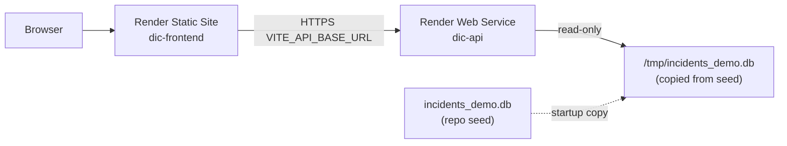

# Render deployment — DevOps Incident Commander (public demo)

**Status:** Configuration prepared in-repo; **not deployed** until you connect Render and verify URLs.

## Architecture



## Service 1 — API (`dic-api`)

| Dashboard field | Value |
|-----------------|-------|
| **Type** | Web Service |
| **Runtime** | Python 3 |
| **Region** | Your choice |
| **Branch** | `main` (or your default) |
| **Root directory** | *(repo root)* |
| **Build command** | `pip install -r requirements.txt && python3 create_demo_db.py` |
| **Start command** | `uvicorn main:app --host 0.0.0.0 --port $PORT` |
| **Health check path** | `/health` |

### API environment variables

| Key | Value | Notes |
|-----|-------|--------|
| `DEMO_MODE` | `true` | Required on Render (`RENDER=true` fails start if false) |
| `DEMO_DB_PATH` | `/tmp/incidents_demo.db` | Writable path; ephemeral disk safe |
| `DEMO_DB_SEED_PATH` | `incidents_demo.db` | Seed in repo root |
| `DEMO_DB_REFRESH_ON_START` | `true` | Re-copy seed after restarts |
| `CORS_ALLOWED_ORIGINS` | `https://<your-frontend>.onrender.com` | Comma-separated; must match static site URL exactly (scheme + host, no trailing slash) |
| `PYTHON_VERSION` | `3.11.9` | Optional; matches local testing |

**Do not set** `DB_PATH` to `incidents.db` on public demo. Production DB stays local and gitignored.

### API verification

```bash
curl -sS "https://<api-host>/health" | jq .
# Expect: status=healthy, demo_mode=true, database=/tmp/incidents_demo.db
```

## Service 2 — Frontend (`dic-frontend`)

| Dashboard field | Value |
|-----------------|-------|
| **Type** | Static Site |
| **Root directory** | *(repo root)* |
| **Build command** | `cd frontend && npm ci && npm run build` |
| **Publish directory** | `frontend/dist` |

### Static routes (SPA)

In Render **Redirects/Rewrites**:

| Source | Destination | Action |
|--------|-------------|--------|
| `/*` | `/index.html` | Rewrite |

(`render.yaml` includes this for Blueprint deploys.)

### Frontend environment variables

| Key | Value | Notes |
|-----|-------|--------|
| `VITE_API_BASE_URL` | `https://<api-host>` | **Build-time** only; redeploy frontend after changing |

Local dev leaves this unset and uses the Vite `/api` proxy.

## Deployment order

1. Push repo to GitHub/GitLab (include `incidents_demo.db` or rely on build step `create_demo_db.py`).
2. Create **API** service first; note public URL `https://dic-api-xxxx.onrender.com`.
3. Create **Static Site**; set `VITE_API_BASE_URL` to API URL; deploy and note `https://dic-frontend-xxxx.onrender.com`.
4. Set API `CORS_ALLOWED_ORIGINS` to the static URL; **manual deploy** API.
5. Hard-refresh browser; confirm dashboard, timeline, and `/incidents/:id` refresh.

## Blueprint

Connect repo with `render.yaml` in the root, then set sync-false env vars in the dashboard:

- `CORS_ALLOWED_ORIGINS`
- `VITE_API_BASE_URL`

## Security notes

- Demo middleware blocks POST/PATCH/DELETE (except allowed investigate POST returning mock data).
- OpenAPI `/docs` disabled in demo mode.
- No secrets required for the public demo; never commit `.env` or production `incidents.db`.

## Local parity commands

```bash
python3 -m pytest test_demo_db_setup.py test_app.py -q
DEMO_MODE=true DEMO_DB_PATH=incidents_demo.db python3 test_demo_mode.py
cd frontend && npm run build && npx tsc --noEmit
```
